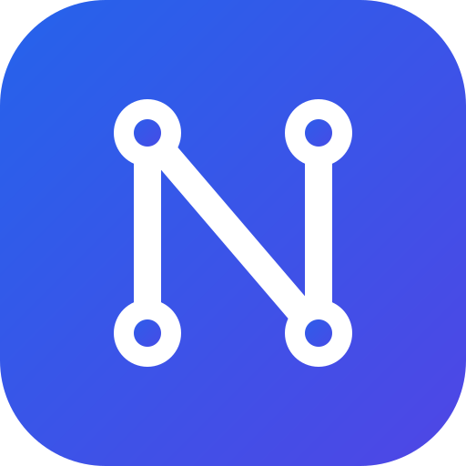

# NEXUS_ — saiba o lucro real de cada pedido

Painel gratuito para vendedores do **Mercado Livre** (Shopee em breve). Mostra quanto você realmente ganhou em cada venda, já descontando comissão, frete, imposto, custo do produto, Ads e devoluções.

## Seus dados são seus. Ponto.

Muitas plataformas que se conectam à sua loja guardam seus pedidos, custos e margens em servidores deles. Esses dados mostram quanto você paga pelos produtos, qual é sua margem e o que vende mais, e é exatamente o que um concorrente gostaria de ter. O NEXUS_ foi feito para que isso **não aconteça**:

| | |
|---|---|
| 🖥️ **Tudo fica no seu computador** | Pedidos, custos, margens e relatórios ficam num banco de dados dentro do seu PC. Não existe servidor nosso guardando suas informações. |
| 🔒 **Seu custo e sua margem nunca saem daí** | O custo que você digita por produto só existe na sua máquina. Ninguém consegue ver, copiar ou vender. |
| 🚫 **Sem cadastro, sem conta, sem mensalidade** | Você não cria login conosco e não nos informa e-mail, CPF ou CNPJ. |
| 👁️ **Sem rastreamento** | Não há anúncios, analytics nem telemetria. O app só conversa com o Mercado Livre (e o Mercado Pago, para dados de pagamento dos seus pedidos), com o intermediário de login e com o GitHub (para buscar atualizações). Veja a lista completa em [PRIVACIDADE.md](PRIVACIDADE.md). |
| 🔑 **Acesso protegido** | As autorizações das suas lojas são guardadas **cifradas** pelo cofre do próprio Windows. O painel interno só responde ao próprio app, e outros programas e sites do seu computador são bloqueados. |
| 📖 **Código aberto** | Qualquer pessoa pode ler o código e conferir que é assim (licença MIT). Você não precisa confiar na nossa palavra. |
| 👀 **Só leitura (quase sempre)** | O app apenas consulta suas lojas. A única tela que altera algo é **Descontos**, e só quando você mandar aplicar. |

### O único ponto na internet: o login
Para o Mercado Livre liberar o acesso à sua loja, é preciso uma "senha do aplicativo" que não pode ficar dentro do programa. Ela fica num pequeno **intermediário de login** (código aberto, em `broker/`), que apenas repassa o pedido de autorização ao Mercado Livre. Ele **não tem banco de dados nem registro de nada**: seus pedidos, custos e margens jamais passam por ele. As autorizações ficam só no seu computador.

### Você está no controle
- Para desconectar uma loja, clique em **Desconectar** na tela **Contas** (o acesso é apagado do computador) e, se quiser, revogue o acesso na sua conta do Mercado Livre.
- Para apagar tudo, desinstale o app e apague a pasta `%APPDATA%\NEXUS_`.
- Seus custos têm cópia de segurança automática, também no seu computador.

## O que você ganha

- **Lucro real por pedido**, com comissão, frete, imposto (Simples), custo do produto, Ads e devoluções.
- **Dashboard** com meta do mês, vendas por dia, por conta, por estado, top produtos e recomendações.
- **DRE mensal** e indicadores de rentabilidade.
- **Curva ABC e análise por produto (SKU)**, com sinais do que vale a pena manter, reajustar ou parar.
- **Calculadora de preço e margem.**
- **Ads**: ACOS comparado com a sua margem, para saber qual campanha dá lucro de verdade.
- **Promoções e descontos** (inclusive em massa), mostrando a margem de cada preço antes de aplicar.
- **Devoluções, envios, atendimento, reputação e Full/estoque.**
- **Alertas** do que precisa de atenção.
- **Várias contas/lojas** do Mercado Livre no mesmo painel.
- **Shopee: em breve.**

## Como instalar (Windows)

1. Baixe o instalador `NEXUS_ Setup <versão>.exe` na página de [Releases](https://github.com/douglastomieiro/ydata/releases/latest) e rode.
   > Como o instalador ainda não tem assinatura digital paga, o Windows pode mostrar "O Windows protegeu o computador". Clique em **Mais informações → Executar assim mesmo**.
2. Abra o **NEXUS_**. Na primeira vez ele abre a tela **Contas**.
3. Clique em **Copiar link de autorização**, cole no navegador em que sua conta do Mercado Livre está logada e clique em **Autorizar**. Com mais de uma loja, repita no navegador (ou perfil) de cada conta. Depois volte ao app e clique em **Reiniciar agora**.
4. Aguarde a primeira carga, que busca 12 meses de pedidos (pode levar algumas dezenas de minutos). O painel já funciona enquanto carrega.
5. Em **Configurações**, informe a alíquota do Simples de cada conta e, em **Custos**, o custo de cada produto.

> **Dica:** o lucro só é tão preciso quanto os custos que você informa. Produto sem custo conta como R$ 0. Em **Custos** dá para colar `SKU;custo` em lote, direto de uma planilha.

**Atualizações automáticas:** o app procura versão nova ao abrir e a cada 6 horas, confere a integridade do arquivo e pergunta se você quer reiniciar. Suas contas e dados continuam intactos.

## Como o lucro é calculado

`lucro = receita − devolução − comissão − frete do vendedor − imposto − custo do produto − Ads`

- **Comissão e frete** vêm direto do Mercado Livre, pedido a pedido (a comissão confere com a fatura).
- **Imposto**: a alíquota do Simples que você informa, aplicada sobre a receita e o frete cobrado do comprador na nota.
- **Ads**: o gasto de cada anúncio no dia é dividido entre os pedidos daquele dia.
- **Devoluções**: saem da receita, e entram como perda o frete, as tarifas e a comissão que não foram estornados.
- O dia comercial segue o horário de Brasília.

## Dúvidas, problemas ou sugestões

Abra uma [issue](https://github.com/douglastomieiro/ydata/issues). Não coloque tokens, senhas nem dados da sua loja ao relatar um problema.

---

Documentação técnica (publicar versões, intermediário de login, modo avançado, estrutura do código): [docs/DESENVOLVIMENTO.md](docs/DESENVOLVIMENTO.md).

[Política de privacidade completa](PRIVACIDADE.md) · Licença MIT — veja [LICENSE](LICENSE).
